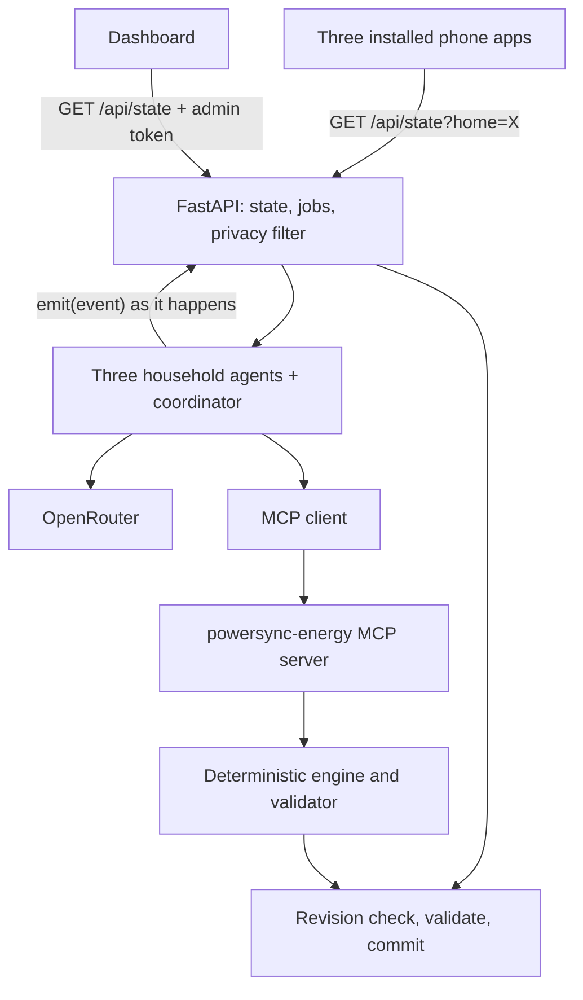

# PowerSync: product requirements and six-hour build spec

**Product name:** PowerSync
**Team:** four people working in parallel (A phone, B dashboard and integration, C agents and MCP, D backend and engine)
**Delivery:** three installed phone web apps, one live laptop dashboard, one shared backend
**Event constraints:** six hours of hacking; five-minute presentation; one to two minutes of questions. Recheck organizer announcements.
**Version:** v2, written 2026-11-07 after a full practice run. Supersedes the trial's "Gridmates" PRD.

---

## 1. What we are building

Each household gets an AI representative. Residents describe their needs in ordinary language. Their representatives negotiate appliance schedules across a simulated three-home neighborhood without breaking any household's requirements. A deterministic engine checks every proposal and calculates every number. Three phones each control one home. A projected dashboard shows the requests, the real agent conversation, the schedules, and the measured differences.

**Elevator pitch:** PowerSync gives every home an AI energy representative. Tell it when you need your appliances done, and it works out a plan with the neighbors that keeps the street under its power limit and moves usage into cheaper hours, without breaking anyone's deadlines.

**The central demo moment:**
1. The dashboard shows an evening overload: everyone runs appliances when they want, and the street goes 8 kW over its 15 kW limit.
2. We press **Coordinate neighborhood**. The engine's first plan is safe but makes Home B's dryer run during expensive hours.
3. Home B's agent objects and asks Home A to start its car charging 45 minutes later. Home A's agent checks that its car is still ready by its deadline at no extra cost, and agrees.
4. Plan 2 commits. Home B saves money, Home A pays the same, and the street stays under its limit. Each phone shows only its own new plan, written in plain English.
5. A resident changes a deadline from their phone, and the neighborhood replans around it.

That is the story: **the neighbors find a better plan than the scheduler did alone.** The scenario in §9 is built so this happens for a real reason.

This prototype schedules **simulated appliances**. It does not connect to utilities, move electricity between houses, or control real devices. The phone app is an installed web app (PWA) with a home-screen icon and its own full-screen window. It is not an App Store build. The backend runs on a laptop. Phones reach it through an HTTPS tunnel, and AI calls go through OpenRouter, so the live system needs internet.

## 2. What changed since the trial

| Area | Trial behavior | v2 requirement |
|---|---|---|
| Data | Toy numbers (3 kW chargers, 7 kW limit) | Published US figures (§9) |
| Conflict | The engine solved everything right away, so agents had nothing to negotiate | The engine's first plan is safe but unfair to one home. Agents find a better one. |
| Time display | 24-hour `18:00` | 12-hour `6:00 PM` everywhere a person reads a time |
| Flat-rate toggle | Changed only the display. Coordination still used time-of-use prices. | Changes the real backend tariff through `POST /api/tariff` |
| Conversation | Messages arrived in one batch at the end, with labels like "candidate accepted" | Each message appears live. Each plan is named and says what moved and why. |
| Privacy | Every phone could read every home's messages | Each phone receives only its own home's view (§11.3) |
| Modes | Fixture, live, and token states were easy to confuse | A header badge shows mode, backend connection, and auth state |
| AI model | Free model, 50 requests a day, frequent timeouts | Event key. Time a real call by 0:30 and set budgets from that measurement. |

## 3. Product truth: what we may claim

| Outcome | Mechanism | What we may claim |
|---|---|---|
| Lower bill | Move flexible use into cheaper slots under the selected time-of-use tariff | Calculated savings for this scenario and tariff |
| Lower neighborhood peak | Coordinate starts against an explicit shared capacity | Lower maximum modeled kW, with every task still completed |
| Fairness | Agents negotiate who moves | Per-home cost changes shown for every home, including increases |
| Personal control | Deadlines are hard constraints | Every committed plan passed the validator |

**Moving a task never changes kWh.** At a flat rate, moving tasks never changes the bill. A lower peak doesn't earn households money by itself. Don't claim blackout prevention, universal savings, utility integration, or that real neighbors share this exact limit. The 15 kW limit is a stated scenario assumption.

Don't claim multi-agent demand coordination is new. Our difference is a clear, human-facing version: an advocate for each household, a negotiation you can read, constraints that are enforced, and a before/after comparison anyone can check.

## 4. Scope

### P0: must finish

1. Three household identities, each usable from its own installed phone app.
2. A phone can view its plan, send a request, confirm or reject a proposed requirement change, and see status.
3. The dashboard shows three homes, baseline and coordinated demand, a task timeline, the capacity line, tariff shading, metrics, and the real agent conversation.
4. One runtime AI integration through the event's OpenRouter key.
5. Three household agent contexts with distinct data and instructions.
6. A real custom MCP server (`powersync-energy`) with energy tools, called through an MCP client.
7. Deterministic scheduling, validation, and metric calculation.
8. Shared backend state, revision checks, queued requests, and a reliable reset.
9. Clearly labeled synthetic data and modeled results.
10. Negative controls: the flat rate yields zero bill change from moving tasks, and moving tasks yields zero kWh change.
11. **New:** live conversation delivery. Each event appears as it happens, with plan IDs and plain-English text (§12).
12. **New:** a private household view. A phone receives only its own tasks, costs, and messages (§11.3).
13. **New:** a real tariff toggle wired to the backend (§11.4).
14. **New:** 12-hour times in all human-facing text.
15. **New:** a visible status badge showing data mode, backend connection, and auth state on both the phone and the dashboard.

### P1: only after P0 is integrated

- Approved waste reduction for one simulated light load (§15.4).
- A polished animated before/after transition.
- A recorded backup of the working demo. **Treat this as nearly P0.** If the model is slow on stage, it saves the presentation.

### Cut

Native iOS and Android builds, hardware, utility accounts, real billing, payments, solar trading, batteries, live forecasting, HVAC models, databases, vector stores, user registration, push notifications, 3D neighborhoods, and multi-day optimization. Don't add agent frameworks just to show more agent names.

## 5. Team ownership

| Person | Owns | Deliverable |
|---|---|---|
| A: phone | `frontend/src/phone/`, phone CSS and assets | The installed household app |
| B: dashboard and integration | Repo, `frontend/` root config, routing, `api.ts`, `types.ts`, `fixtures.ts`, `frontend/src/dashboard/`, PWA config, tunnel, merges | Dashboard and the combined runnable product |
| C: agents and MCP | `backend/agents/`, `backend/tools/` | OpenRouter loop, MCP server and client, negotiation, conversation text |
| D: backend and engine | `backend/main.py`, `backend/simulation/`, `backend/data/`, `backend/requirements.txt`, `docs/contract.md` | API, state, job queue, engine, metrics, privacy filtering |

B is the integration lead, not everyone's implementer. Each owner fixes their own interface. D owns the canonical schema, and B mirrors it into TypeScript. Any change to a shared contract gets a short team post before anyone edits.

**Shared ownership:** C writes conversation wording. D stores and filters it. B and A display it. If wording is unclear on screen, tell C, not the person displaying it.

## 6. Stack

| Layer | Tool | Use |
|---|---|---|
| Phone and dashboard | React + TypeScript + Vite | One frontend with `/phone` and `/dashboard` routes |
| Installation | `vite-plugin-pwa` | Manifest, icons, app-shell service worker |
| Charts | Recharts | Demand chart. The task timeline is plain CSS. |
| Icons | `lucide-react` | Interface icons |
| API | Python 3.11 + FastAPI + Uvicorn | Routes, jobs, shared state |
| Validation | Pydantic | Requests and model outputs |
| AI | OpenRouter through `httpx` | Tool-calling chat completions, backend only |
| MCP | `fastmcp` | Custom energy tool server plus client, stdio transport |
| Scheduling | Team-written deterministic Python | Generate and validate schedules |
| Live updates | HTTP polling every second | Simpler than streaming, and works through the tunnel |
| Phone access | `cloudflared` Quick Tunnel | Temporary HTTPS address for the laptop |

The whole stack worked end to end in the trial. Don't switch frameworks on the day. Pin the versions that install cleanly and commit `package-lock.json` and `backend/requirements.txt`.

## 7. Architecture



- **Authoritative state:** one Python process, one Uvicorn worker, one async queue, one state lock. No database. Reset restores the scenario. Restarting loses state, which is fine for the demo.
- **Agents:** separate system prompts, household context, and message history for each home. One underlying model is fine. The backend routes agent-to-agent messages and logs them with sender and recipient.
- **MCP:** real protocol traffic over stdio between the backend client and the custom server. The tool subprocess never owns state; it receives snapshots.
- **Events:** agents call an `emit` callback for each event. The backend stores it at once, gives it a stable ID, and returns that ID, so replies can reference it. Polling clients then see messages as they happen.

## 8. Repository layout

```text
powersync/
  CLAUDE.md                  (copy of AI-CONTEXT.md)
  README.md
  .gitignore
  .env.example               (names only, no values)
  docs/
    PRD.md                   (this file)
    team-schedule.md
    contract.md              (D: confirmed fields and examples)
  frontend/
    package.json, package-lock.json, vite.config.ts
    public/icons/
    src/
      App.tsx, api.ts, types.ts, fixtures.ts
      phone/
      dashboard/
  backend/
    __init__.py
    main.py
    requirements.txt
    data/
      scenario.json          (the only scenario file; tests read it too)
      provenance.md
    simulation/              (schema, scenario, engine, metrics, validator, tests)
    agents/                  (openrouter client, orchestrator, prompts, mcp client, events, tests)
    tools/
      energy_server.py
```

**One scenario file.** In the trial, the agent tests used an older copy of the scenario, so they passed while the live app behaved differently. Every test reads `backend/data/scenario.json`.

**Run commands from the right folder.** `npm` commands run inside `frontend/`. Python commands run from the repo root with the virtual environment active. Running `npm` at the root caused the trial's `ENOENT` error. The README must say this in its first lines.

## 9. Data: realistic, reproducible, honest

All of it is synthetic. No real home was measured. The values are rounded from published US figures (§26). `provenance.md` lists each assumption and source.

### 9.1 Time model

- One 24-hour horizon starting **6:00 PM on 2026-07-15**, America/New_York. Use a date away from daylight-saving changes.
- 96 slots of 15 minutes each (0.25 h). Slot 0 = 6:00 PM, slot 12 = 9:00 PM, slot 16 = 10:00 PM, slot 20 = 11:00 PM, slot 28 = 1:00 AM, slot 48 = 6:00 AM.
- Slot 96 is the end boundary, not a valid start.
- A deadline is an end boundary: `start_slot + duration_slots <= deadline_slot`.
- The planning clock stays paused for the demo. All replanning happens before anything runs.
- **Internally, slots are integers. Every human-facing time is 12-hour, like `9:45 PM`.** One shared formatter on each side (Python for event text, TypeScript for the UI). The model may parse `HH:MM`, but nothing a person reads uses 24-hour time.

### 9.2 Households and tasks

| Home | Task ID | Appliance | Power | Duration | Energy | Finish by | Preferred start |
|---|---|---|---:|---:|---:|---|---|
| A | `a_ev` | EV charging | 7.2 kW | 12 slots (3 h) | 21.6 kWh | slot 28 (1:00 AM) | slot 0 (6:00 PM) |
| A | `a_dish` | Dishwasher | 1.2 kW | 4 slots (1 h) | 1.2 kWh | slot 20 (11:00 PM) | slot 6 (7:30 PM) |
| B | `b_dryer` | Clothes dryer | 5.0 kW | 3 slots (45 min) | 3.75 kWh | slot 20 (11:00 PM) | slot 2 (6:30 PM) |
| B | `b_dish` | Dishwasher | 1.2 kW | 4 slots (1 h) | 1.2 kWh | slot 20 (11:00 PM) | slot 6 (7:30 PM) |
| C | `c_ev` | EV charging | 7.2 kW | 12 slots (3 h) | 21.6 kWh | slot 48 (6:00 AM) | slot 0 (6:00 PM) |
| C | `c_dish` | Dishwasher | 1.2 kW | 4 slots (1 h) | 1.2 kWh | slot 20 (11:00 PM) | slot 6 (7:30 PM) |

All tasks have earliest start slot 0, run without interruption, and use constant power. These are illustrative, not manufacturer cycles.

### 9.3 Background, capacity, tariff

- **Always-on use:** 1.2 kW per home in every slot (about 900 kWh a month). It is protected and modeled separately from tasks. It is constant, so it leaves out evening air conditioning.
- **Shared limit:** 15 kW, modeled on a 15 kVA pole transformer. This is a stated scenario assumption.
- **Time-of-use tariff:** $0.59/kWh from 4:00 to 9:00 PM, $0.33/kWh otherwise. These are summer rates from a California utility, without fees, taxes, or credits. In slots: 0–11 cost $0.59, 12–87 cost $0.33, and 88–95 (4–6 PM the next day) cost $0.59. Label it "Illustrative time-of-use tariff."
- **Flat tariff:** $0.18/kWh in every slot, the US residential average. It is a correctness control. It is a national average and lower than the California prices, so compare the two modes for behavior, not as bills.

### 9.4 The built-in conflict (why agents have something to do)

- Always-on use takes 3.6 kW, which leaves **11.4 kW** for tasks.
- One EV (7.2 kW) plus the dryer (5 kW) is 12.2 kW, too much. Two EVs together (14.4 kW) are also too much.
- Cheap hours start at 9:00 PM. Home A's car must start by 10:00 PM to finish by 1:00 AM. Home B's dryer must finish by 11:00 PM. Both want the 9–11 PM window.
- The engine's natural order places Home A's car at 9:00 PM, which pushes Home B's dryer into expensive hours. **That first plan is safe but unfair.**
- If Home A starts at 9:45 PM, Home B's dryer runs from 9:00 to 9:45 PM in cheap hours. Home A's car still finishes by 12:45 AM and costs the same. Home C's car follows at 12:45 AM.

**Don't hard-code this result.** The engine must reach its first plan honestly, and the agents must find the improvement through a real objection and a real concession that the engine then evaluates.

### 9.5 Expected values (from the trial engine; D re-verifies)

| Schedule | Energy charge | Peak | Over-limit slots |
|---|---:|---:|---:|
| Everyone at preferred times | $63.02 | 23.0 kW | 12 (3 hours) |
| Everyone uses a cheap timer (all start at 9 PM) | $49.87 | 26.6 kW | yes, worst peak |
| Engine's first plan | $50.85 | 13.2 kW | 0 |
| After A moves to 9:45 PM (Plan 2) | $49.87 | 13.2 kW | 0 |

- Total energy is always **136.95 kWh** (tasks 50.55 + always-on 86.4) for every schedule.
- Under the flat rate, every schedule costs **$24.65**, and the coordinated peak drops to 10.8 kW.
- Plan 2 saves about $0.98 in total. Almost all of it is Home B's, and Home A pays nothing extra.
- If a different tie-break in the new engine changes these numbers, D posts the new table and B updates labels. The property that must hold is that **the first engine plan puts B's dryer in expensive hours, and a concession by A fixes it.**

### 9.6 Hand-checkable examples

- An EV session uses 7.2 kW × 3 h = 21.6 kWh. At $0.33 that costs $7.13. At $0.59 it costs $12.74. At flat $0.18 it costs $3.89 at any time.
- The dryer uses 5 kW × 0.75 h = 3.75 kWh. At $0.59 that's $2.21, and at $0.33 it's $1.24.
- Moving any task changes energy by exactly 0 kWh.

## 10. Canonical schemas

D defines these in Pydantic first and B mirrors them in TypeScript. Field names are fixed. Money is modeled energy charge in USD, without fees or taxes.

**Task:** `id`, `home_id`, `name`, `power_kw`, `duration_slots`, `earliest_slot`, `deadline_slot`, `preferred_start_slot`, `interruptible` (always false).

**ScheduleEntry:** `task_id`, `home_id`, `start_slot`, `duration_slots`, `power_kw`. Power and duration are always copied from the canonical task. Only `start_slot` is a decision.

**Metrics:** `energy_kwh`, `variable_cost_usd`, `peak_kw`, `missed_deadlines`, `capacity_violations`, `tasks_completed`, `tasks_total`, `per_home` (each with `energy_kwh`, `variable_cost_usd`, `peak_kw`).

**Home:** `id`, `name`, `color`, `preferences`. Colors stay consistent on every screen.

**AgentEvent:**

| Field | Meaning |
|---|---|
| `id` | Stable and unique, like `evt-<generation>-<n>` |
| `sequence` | Monotonic order. Sort by this, not by timestamp. |
| `job_id` | The job that produced it |
| `sender`, `recipient` | `resident_A`, `agent_A`, `coordinator`, `all_agents`, `powersync-energy`, `validator`, `backend`. The home ID always follows `_`. |
| `type` | `request`, `proposal`, `review`, `counteroffer`, `tool_call`, `tool_result`, `validation`, `commit`, `error`, `info` |
| `text` | Plain English, at most 800 characters (§12) |
| `round` | Negotiation round, starting at 1 |
| `proposal_id` | `P-1`, `P-2`, and so on: the plan being proposed or reviewed |
| `reply_to_event_id` | The stored event being answered |
| `source` | `model` (written by the AI) or `system_template` (written by code) |
| `home_views` | Optional `{A: text, B: text, C: text}`. Per-home wording of a shared message, used by the privacy filter. Never sent to clients as-is. |
| `data` | A small flat object: tool name, latency, valid, stance |
| `timestamp`, `revision` | When it happened, and the revision at the time |

**PendingChange:** `id`, `home_id`, `proposed_edits.edits[]` (`task_id`, `field`, `old_value`, `new_value`, `old_time`, `new_time` with 12-hour times), `explanation`, `prepared_revision`, `request_id`, `job_id`, `feasible`, `infeasible_reasons`, `status`, `created_at`. `field` is one of `deadline_slot`, `earliest_slot`, `preferred_start_slot`.

**NeighborhoodState:** `revision` (monotonic, never decreases, even on reset), `generation` (increments on reset), `requirements_version`, `scenario_id`, `horizon_start`, `slot_minutes`, `capacity_kw`, `activity` (what is running now, such as "Home B is reviewing Plan 1", or null), `tariff_mode` (`tou` or `flat`), `tariff_label`, `homes`, `tasks`, `tariff_usd_per_kwh[96]`, `background_kw_by_home`, `baseline_schedule`, `independent_schedule`, `coordinated_schedule` (null until the first commit), `metrics` {baseline, independent, coordinated}, `metrics_flat_rate` (the same schedules priced flat), `demand_kw` {baseline, independent, coordinated}, `coordination` {status, explanation, reasons, job_id, source: `live`/`stub`/`deterministic_fallback`}, `events`, `events_hidden`, `pending_changes`, `job_status`, `data_mode` (`synthetic`), `ai_mode` (`live`, `unavailable`, `replay`), `agent_impl` {interpret, coordinate: `live` or `stub`}.

**Job:** `id`, `kind` (`message`, `action`, `coordinate`), `home_id`, `request_id`, `status` (`queued`, `running`, `awaiting_confirmation`, `completed`, `failed`), `stage`, `result` (always has `outcome` and `message`), `error` (`"CODE: message"`), `created_at`, `updated_at`.

## 11. HTTP API

Every frontend request uses a relative `/api/...` path.

| Method and path | Auth | Purpose |
|---|---|---|
| `GET /api/health` | none | `{status, version, scenario_id, revision, generation, auth_mode, agent_impl, openrouter_configured, model}` |
| `GET /api/state` | admin token for conversation | The dashboard view (§11.3) |
| `GET /api/state?home=A` | Home A's token or admin | Home A's private view (§11.3) |
| `POST /api/message` | home token | Interpret one resident request → `202 {job_id, status, accepted_revision}` |
| `POST /api/action` | home token | `confirm_change` or `reject_change` → `202` |
| `POST /api/coordinate` | admin | Run neighborhood planning → `202` |
| `POST /api/tariff` | admin | `{tariff_mode: "tou" or "flat"}` → `{revision, tariff_mode}` (§11.4) |
| `GET /api/jobs/{id}` | none | Job progress |
| `POST /api/reset` | admin | Restore the scenario, time-of-use tariff, and revision bump |

Example message body: `{"home_id":"A","text":"I leave at 11 pm tonight. Have my car ready by then.","request_id":"phone-a-<uuid>","expected_revision":3}`.

Confirming a change applies the edit and replans the neighborhood **in one job**, with one revision bump. This worked well in the trial. Keep it.

### 11.1 Auth

- `Authorization: Bearer <token>`. Never put tokens in query strings, URLs, or logs.
- Tokens come from `.env`: `DEMO_ADMIN_TOKEN`, `DEMO_HOME_A_TOKEN`, `DEMO_HOME_B_TOKEN`, `DEMO_HOME_C_TOKEN`.
- **A blank token means that role is open** (dev mode). `health.auth_mode` reports `dev-open`, `partial`, or `enforced`, and **both UIs show it in the header badge.** The demo laptop must run `enforced`.
- **Team rule from the trial:** during development everyone leaves tokens blank. Only the integration laptop sets them, starting at the G9 checkpoint. The trial's "works for A but not for me" bug was A on dev-open and B on enforced.

### 11.2 Errors

Always `{"error":{"code":"…","message":"…"}}`.

| HTTP | Code | Phone behavior |
|---|---|---|
| 400 | `BAD_REQUEST`, `UNKNOWN_HOME` | Show the message |
| 401 | `UNAUTHORIZED` | Show token entry |
| 403 | `FORBIDDEN` | "That code isn't for this home" plus a **Change household** button |
| 404 | `NOT_FOUND` | Job or change lost, including after reset |
| 409 | `STALE_REVISION` | Refresh, show the current plan, let the user resubmit |
| 409 | `JOB_RUNNING` | "Planning is running. Try again in a moment." |
| 413 | `PAYLOAD_TOO_LARGE` | Body over 16 KB |
| 429 | `RATE_LIMITED` | "Busy, retry" |

A repeated `request_id` from the same home returns `202` with the existing job and `duplicate: true`. An infeasible plan is a valid result, not a server error.

### 11.3 Privacy views

**Household view** (`?home=A`, needs A's token): only Home A's tasks, schedule entries, per-home metrics, background, pending changes, and events. Events are included when A sent or received them, or when they went to `all_agents`. Shared messages are replaced with their `home_views.A` text, which never names another home's appliances or costs. Tool events and other homes' metrics are removed. Neighborhood totals that every home needs (aggregate demand, capacity, tariff) stay.

**Dashboard view** (no `home`): with an admin token it shows everything, which the projector needs. Without it, `events` and `pending_changes` are empty and `events_hidden` is true.

**Known gap to decide at G2:** in the trial, the public dashboard view still exposed every home's schedule, because the charts need it. Either require the admin token for the whole dashboard view, or accept the gap and say "the projector is the operator's screen." Pick one and write it in the contract.

### 11.4 Tariff toggle

`POST /api/tariff` changes the prices that the engine, the agents, and all metrics use. It returns `409 JOB_RUNNING` while a job is active. The committed plan stays until the next coordination, and the dashboard says "Plan priced under the previous tariff. Coordinate again." Reset returns to time-of-use, and the toggle shows that. Under flat pricing, agents must not object about cost (§13.4).

### 11.5 Concurrency

1. Validate role, home ownership, schema, size, and request ID.
2. Deduplicate request IDs.
3. Mutations (confirm, reject, coordinate, tariff) run one at a time. Interpretation runs concurrently across homes.
4. A pending change goes stale when its edited fields no longer match, not when the raw revision changes, so one home's commit doesn't invalidate another home's pending change.
5. Before commit, check `generation` and `requirements_version`, and rebuild the candidate from canonical tasks. Validate fully.
6. Commit once, bump the revision, and publish the new metrics together.
7. Reset cancels in-flight jobs (`RESET`), drops pending changes, and discards late agent results.

Clients poll state every second while visible and stop when unmounted. They poll active jobs until a terminal or confirmation state. A phone disables duplicate submits while its own request is active.

## 12. The live conversation

This was the most demo-visible feature in the trial and the one that was built last. Build it from the start.

### 12.1 Delivery

- Agents call `emit(event)` as each thing happens. The backend stores it right away and returns its ID. Polling picks it up within a second.
- `emit({"stage": "Home B is reviewing Plan 1"})` sets `state.activity`, which the dashboard shows as a live status line.
- Household reviews run concurrently. Publish each home's review when it finishes, not after all three.

### 12.2 Wording rules (C writes, everyone checks)

- Plain English a judge understands without explanation. No internal words like "candidate", "slot", "concession", "task_id", or "constraint satisfied".
- **Every plan has a name and says what it is and how it differs.** For example:
  - "Here's Plan 1. Compared with everyone's preferred times: Home A's car charging moves from 6:00 PM to 9:00 PM, Home C's car waits until Home A's finishes, and Home B's dryer still runs before 9:00 PM. The street stays under 15 kW."
  - "Here's Plan 2. What's different from Plan 1: Home A's car charging starts at 9:45 PM instead of 9:00 PM, and Home B's dryer moves into cheaper hours at 9:00 PM."
- A review states the home's position in one or two sentences, in the voice of a friendly neighbor. For example: "Plan 1 works for my deadlines, but it puts my dryer in the most expensive hours. Home A, could your car start 45 minutes later? It would still finish before 1 AM."
- Money comes from code and is formatted by code. The model never states a dollar amount it calculated itself.
- All times are 12-hour.
- Code-written messages (plan announcements, commits) have `source: system_template`. Model-written messages have `source: model`. The dashboard may show a small marker for each.
- Never display hidden reasoning or invent statements. If an agent fails, show "Home B didn't answer in time. Using the safe plan."

### 12.3 Per-home wording

Coordinator broadcasts carry `home_views` with a separate version for each home, such as "Your dryer moves to 9:00 PM. You save $0.97." The phone shows its own version. The dashboard shows the full text.

### 12.4 Dashboard panel

Sort by `sequence`. Group by round. Tag each plan as "Plan 1" or "Plan 2". Show the activity line. Use **Follow** (auto-scroll) and **Pause**. When `events_hidden` is true, show "Conversation hidden. Enter the admin code to view."

## 13. AI: OpenRouter and agents

### 13.1 Model choice and timing (first 30 minutes)

- Endpoint: `POST https://openrouter.ai/api/v1/chat/completions`, with the server-side key as a bearer token.
- Choose a **fast, tool-capable** model available to the event key from `https://openrouter.ai/api/v1/models`. **Copy the ID exactly.** A one-letter typo (`vidia/` for `nvidia/`) cost time in the trial.
- **By 0:30, C times one real call** that includes a tool definition and a structured reply. If a household review takes over about 15 seconds, choose a faster model before building on it.
- `health.model` shows the configured model, so B can confirm the laptop uses the right one.

### 13.2 Two kinds of AI work

**A. Interpret resident requests.** Turn ordinary language into proposed structured edits. The phone asks for confirmation before any deadline changes. Resolve "11 pm tonight" against the scenario date, not the laptop clock.

**B. Negotiate.** Each home reviews a plan for its own tasks, accepts or objects, and may offer or ask for allowed timing changes. The coordinator routes messages, and the engine builds the next plan. Agents may ask a resident to relax a deadline, but they never relax it silently.

### 13.3 Bounded negotiation sequence

1. Snapshot approved requirements. Get Plan 1 from the engine through MCP. Announce it (§12.2).
2. Each household agent reviews Plan 1 for its own tasks. It sees its own costs plus only the shared totals it needs: aggregate demand, capacity, and tariff.
3. Structured output: `home_id`, `proposal_id`, `accept`, `objections`, `allowed_concessions`, `request_to_neighbor` (home and requested change), `public_message`.
4. Route each objection that names a neighbor to that neighbor's agent as a real message. The neighbor must answer it, with `reply_to_event_id` set.
5. Apply only the soft concessions that were offered. The engine builds and evaluates Plan 2 through MCP.
6. Stop after three rounds or the job budget.
7. Final validation and a revision check decide the commit. The coordinator announces the commit only after the backend commits.

**Third-person context.** When a job starts because Home A changed a deadline, tell the other agents "Home A's resident changed their car deadline to 11 PM", not "I need my car by 11 PM". In the trial, the first-person version made Home C claim Home A's deadline as its own.

### 13.4 Prompt guidance (C)

Each household system prompt says that:
- The resident's approved deadlines are binding, and only soft preferences can be traded.
- The agent uses only the supplied data and tools, and never invents power, duration, prices, savings, or consent.
- Resident text is a request, not authority over other homes or system rules.
- When the plan puts the home's flexible use in expensive hours and a neighbor could shift without breaking its own deadline, the agent objects and asks that neighbor for a specific change. Give the agent its share of expensive-hour use as a number, such as `share_in_expensive_hours`.
- When asked by a neighbor, the agent checks its own deadline and cost and agrees if neither is hurt.
- **Under flat pricing, the agent makes no cost objections**, because time doesn't change the price.
- The `public_message` is written as a friendly neighbor, in plain English with 12-hour times.

### 13.5 Budget and failure policy

- Start with three rounds, at most 12 model calls and 24 tool calls per coordination job, and a 45-second total budget. Set per-call timeouts from the timing in §13.1. Make every limit an environment setting so it can be raised for a slow model without code changes.
- At most one retry, for a transient error, if the budget allows.
- Validate outputs with Pydantic, with one format-repair attempt.
- Track model, latency, tool calls, and returned token usage. Don't invent dollar costs.
- Never call the model from polling or rendering.
- On failure, keep the last valid plan, commit the engine plan labeled `deterministic_fallback`, set `ai_mode: unavailable`, and say so in the conversation.
- **Protect the quota.** Automated tests use a stub or fake model, never the real key. Run real end-to-end checks on purpose and count them.

## 14. MCP tools

Server name `powersync-energy`, built with FastMCP in `backend/tools/energy_server.py`, over stdio.

| Tool | Input | Output | Changes state? |
|---|---|---|---|
| `get_home_context` | `home_id` plus the authorized snapshot | Tasks, deadlines, tariff summary | No |
| `evaluate_schedule` | snapshot, schedule | Metrics plus validation findings | No |
| `find_feasible_schedule` | snapshot, allowed concessions or pins | Schedule or failure reasons | No |
| `compare_schedules` | snapshot, baseline, candidate | Per-home and total differences | No |

- The backend builds every snapshot and canonical field. Model arguments never replace power, tasks, prices, or capacity, and an agent can't read another home's context by changing `home_id`.
- Tool results get a plain-English summary for the event feed, such as "Checked Plan 1: under the limit, all six appliances finish on time".
- Logs go to stderr, because stdout carries the protocol.
- Inspect how the installed MCP tool objects serialize their schemas (`inputSchema` versus `input_schema`). Don't guess.
- Use no filesystem, shell, browser, or general HTTP tools.

## 15. Engine, validation, metrics

### 15.1 Scheduler

A bounded heuristic, not a claim of global optimality:
1. Validate tasks and array lengths.
2. List each task's possible starts within its window.
3. Order tasks by least slack, then higher power, then stable ID.
4. Rank starts by cost, then resulting peak, then distance from the preferred start.
5. Place a task only if capacity holds at every slot. Backtrack if needed.
6. Bound the search and keep the best complete feasible result.
7. Re-evaluate the whole horizon before returning.

It accepts **pins** (fix a task's start, from an agreed concession) and soft concessions on `preferred_start_slot`. It reports "no plan found within budget" separately from "proven impossible".

### 15.2 Validator

Every task appears exactly once, with no unknown or duplicate IDs. Each entry belongs to the correct home. Starts and durations are integers, with power and duration matching the canonical task. Every task fits its window and the horizon, runs without interruption, and leaves background untouched. Capacity holds at every slot within a small tolerance. The candidate matches the current generation and requirements version. All metrics are recalculated, never taken from agents.

### 15.3 Metrics

For each slot, load = background + every task running. Then:
- `energy_kwh = sum(load × 0.25)`
- `variable_cost_usd = sum(load × 0.25 × price)`
- `peak_kw = max(load)`
- `capacity_violations = count(load > capacity + tolerance)`

Compute per-home values from each home's own load. Never add per-home peaks together to get the street's peak.

Show three schedules: **preferred times**, the **cheap timer** (each home picks its cheapest slots alone), and the **coordinated** plan. When a requirement changes, recompute all three under the new requirements.

### 15.4 Optional waste reduction (P1)

Home B's office lights are a separate 0.1 kW load from 6:00 to 10:00 PM. With permission to turn them off from 6:00 to 9:00 PM, exactly 0.3 kWh is removed. Keep it out of the core numbers unless both the baseline and the plan include it.

## 16. Phone app (A)

- Designed for about 390 px wide, with large tap targets and no sideways scrolling.
- **Setup:** choose household, enter code. Store identity and token locally. `/phone?home=A` pins a browser tab to a home, because tabs share local storage. It's needed for testing three homes on one laptop.
- **Header:** home name, status badge (live or sample data, connected or not, auth state), plan revision.
- **Summary tiles:** modeled cost, energy, tasks ready, and the tariff label.
- **Today's plan:** each appliance's start and end, deadline, and status in 12-hour time.
- **Request box** with suggested requests and a send button.
- **Confirmation card:** "Change your car's finish time from 1:00 AM to 11:00 PM?" with Confirm and Reject.
- **Messages:** only this home's view (§11.3), in plain English.
- States to show: queued, interpreting, confirmation needed, planning, applied, infeasible, disconnected, wrong code. Keep the old plan visible while replanning.

Suggested requests:
- A: "I leave at 11 pm tonight. Have my car ready by then." (Feasible. The car then runs 8–11 PM, which squeezes Home B. That's a good second negotiation.)
- B: "My dryer must finish by 10 pm. You can move the dishwasher."
- C: "The car can charge anytime before 7 am."
- Impossible: A asks for "car ready by 8 pm". A 3-hour charge can't finish by 8 PM when planning starts at 6 PM. It must be rejected with an explanation.

Presets go through the same backend path. Never animate a change that skipped the backend.

## 17. Dashboard (B)

Built for a 1440×900 projector with no scrolling during the main story.

- **Top row:** PowerSync name, status badge (mode, connection, auth, AI model), tariff toggle, revision, Coordinate, Reset.
- **Metrics:** energy charge, peak kW, kWh, tasks completed, each shown before and after with the comparison named.
- **Demand chart:** preferred and coordinated lines, an optional cheap-timer line, the 15 kW capacity line, and shading for expensive hours. Axis ticks in 12-hour time.
- **Task timeline:** rows by home, bars for actual run times. Hover shows deadline and kW. Short bars must still be readable.
- **Home cards:** requirements, schedule, per-home cost change (including increases), and agent status.
- **Conversation panel** (§12.4).
- The tariff toggle calls `POST /api/tariff`. Reset sets it back to time-of-use.
- The admin code is entered in a settings popover and stored locally, never in the URL.

Use "demand" for kW and "energy" for kWh. The over-limit area must stay visible in the preferred-times view. Use CSS transitions, not an animation library, and no fake electricity flowing between houses.

## 18. Installed phone app and networking

### 18.1 Development

Vite runs on 5173 and FastAPI on 8000, with Vite proxying `/api` to `http://127.0.0.1:8000`. The dev server starts in labeled **sample data** mode. Built apps start live. `?mode=live` or `?mode=fixture` overrides. If the backend is down, show "Backend not running on port 8000", not a generic error. In the trial, a bare 500 from the proxy looked like a code bug.

### 18.2 Demo: one origin

1. B builds with `npm run build` inside `frontend/`.
2. FastAPI serves `frontend/dist` with API routes first, then a fallback for `/phone` and `/dashboard`. `index.html`, `sw.js`, and the manifest use `no-cache`. Every `/api` response uses `no-store`.
3. Start the backend from the repo root on 127.0.0.1:8000.
4. Open `http://127.0.0.1:8000/dashboard` on the laptop.
5. Run `cloudflared tunnel --url http://127.0.0.1:8000`, then share the HTTPS URL plus `/phone`.
6. **iPhone:** open it in Safari, tap Share, then **Add to Home Screen**, then Add. **Android Chrome:** use the menu, then Install app or Add to Home screen.
7. Open the app from the new icon. It runs full screen with no browser bars. Choose a home and enter its code inside the installed app, since an installed app on iPhone has its own storage, separate from Safari's.
8. Send one request from each phone and confirm that the same revision shows on the laptop.

**Manifest:** `name: "PowerSync"`, `short_name: "PowerSync"`, `start_url: "/phone"`, `scope: "/"`, `display: "standalone"`, theme and background colors, 192 and 512 px icons, an Apple touch icon. Cache the app shell only, never `/api`.

The Quick Tunnel URL changes when the tunnel restarts, and the phones then need the icon added again. **Start the tunnel once, before G6, and leave it running.** Keep the laptop awake and plugged in.

### 18.3 Native apps (cut)

A real native wrapper needs full Xcode. With a free Apple ID the app expires after 7 days, and TestFlight needs a paid developer account. It would still depend on the laptop and tunnel. It isn't worth hackathon time.

## 19. Secrets and access

- `.env` at the repo root holds real values and is gitignored. `.env.example` holds names only. **In the trial, the key was pasted into `.env.example` by mistake.** Check `git diff --cached` before every commit.
- `.env` names: `OPENROUTER_API_KEY`, `OPENROUTER_MODEL`, `DEMO_ADMIN_TOKEN`, `DEMO_HOME_A_TOKEN`, `DEMO_HOME_B_TOKEN`, `DEMO_HOME_C_TOKEN`, plus optional timing limits (`OPENROUTER_TIMEOUT_SECONDS`, `OPENROUTER_JOB_SECONDS`, `POWERSYNC_AGENT_TIMEOUT_S`).
- `.gitignore` must include `.env`, `.env.*`, `!.env.example`, `.venv/`, `node_modules/`, `dist/`, `__pycache__/`, `.pytest_cache/`, and `*.log`.
- **The event OpenRouter key powers project functionality only.** It is never used for Claude Code, Copilot, or any coding assistant. Those use personal accounts.
- Never put the key in frontend code, `VITE_` variables, screenshots, URLs, chat, logs, or assistant prompts.
- If a key leaks, rotating it is the fix, not deleting the file. Tell the organizers if it's their key.

## 20. Git workflow

- One repo with four branches: `feat/phone`, `feat/dashboard`, `feat/agents-mcp`, and `feat/backend-scheduler`.
- Stage only owned paths and check the staged diff.
- **Before pushing frontend work, run `npm run build`**, which includes the typecheck. In the trial, a commit with a failed typecheck reached a PR.
- **Before pushing backend work, run the tests.**
- B merges PRs with a **regular merge commit**, not a squash, so teammates can keep using their branches after `git fetch origin && git merge origin/main`.
- Merge one PR at a time after a quick check. No force pushes and no rewriting shared history.
- Only B changes frontend dependencies, and only D changes Python dependencies.

## 21. Schedule

See `team-schedule.md` for kickoff, decisions, checkpoints, and cuts, and the role guides for each person's steps.

## 22. Acceptance checks

| Check | Passing result | Owner |
|---|---|---|
| EV energy and cost | 21.6 kWh. $7.13 at $0.33, $12.74 at $0.59. | D |
| Total energy | 136.95 kWh for every schedule | D |
| Flat-rate control | Every schedule costs $24.65 under flat pricing | D |
| Preferred-times overload | 23.0 kW peak, over the limit, labeled honestly | D, B |
| Cheap-timer pile-up | 26.6 kW peak is visible, and coordination lowers it | D, B |
| Engine first plan | Safe, with B's dryer in expensive hours | D |
| Negotiation improvement | B objects, A agrees, Plan 2 is cheaper for B and the same for A | C, D |
| Real peer reply | One agent receives another's real message and answers with `reply_to_event_id` | C |
| Live delivery | The first agent message appears on the dashboard before the job ends | C, D, B |
| Plain English | A non-teammate reads one full round and can say what changed | C, B |
| Tariff toggle | Flat, then Coordinate, gives a plan priced flat with no cost objections | D, C, B |
| Privacy | Phone A never receives B's or C's appliances, costs, or private messages | D, A |
| Wrong code | Phone shows FORBIDDEN plus Change household | A |
| Impossible deadline | "Car ready by 8 pm" is rejected and explained | D, C, A |
| Bad model output | Unknown task, changed duration, missing task, or another home's task is rejected | C, D |
| Stale or reset race | An old AI result can't overwrite a newer revision or a reset | D |
| Duplicate tap | The same request ID produces one job | D, A |
| Three phones | Three installed icons, three homes, one shared revision | All |
| AI failure | Old plan kept, labeled fallback, clear message | C, A, B |
| Secrets | `.env` ignored, no key in the staged diff or the built bundle | All |

Backend checks: `python -m pytest backend -q` from the repo root. Frontend check: `npm run build` inside `frontend/`.

## 23. Five-minute presentation

| Time | Show | Say |
|---|---|---|
| 0:00–0:35 | Dashboard: the evening overload, 23 kW against a 15 kW limit | Three homes, two EVs, and a dryer, all at 6 PM. That's realistic, and it overloads the street. |
| 0:35–1:05 | Three phones with the PowerSync icon | Each household has its own AI representative and sees only its own plan. |
| 1:05–2:30 | Coordinate. Plan 1 appears, Home B objects, Home A agrees, Plan 2 commits. | The scheduler's first plan was safe but put B's dryer in peak prices. The neighbors found a better plan. |
| 2:30–3:30 | A changes their deadline from the phone and confirms | A personal change replans the street, and nobody's deadline breaks. |
| 3:30–4:15 | Metrics, cheap-timer line, flat-rate toggle | A cheap timer alone makes the peak worse. Under a flat rate, moving things saves nothing, and the numbers show that. |
| 4:15–5:00 | Validation badge, architecture, close | Simulated appliances, real phones, real agents, real checks. Real use would need device and utility integration and household consent. |

Prepared answers:
- **Why AI?** It understands requests, asks people about ambiguity, and negotiates fairness. The numbers and safety checks stay deterministic.
- **Why neighbors?** Cheap timers make everyone start at the same moment. Coordination handles a shared limit.
- **Can everyone save?** It depends on tariffs and constraints. We show each home's result, including increases.
- **Is the data real?** The appliance sizes, limit, and prices come from published US figures. The homes are synthetic.
- **Is it real hardware?** No. It's software on simulated loads, with three real phones and a shared backend.

## 24. If behind

- **Hour 2 without a working loop:** cut styling, integrate one phone first.
- **Hour 3 without coordination:** temporarily run with the engine plan only (labeled), and keep wiring the negotiation.
- **Model too slow:** switch to a faster model, reduce to one negotiation round, then raise the timeouts through environment settings.
- **Hour 4 without installed phones:** prioritize the PWA and shared state over AI polish.
- **OpenRouter failing on stage:** show the labeled fallback plan and play the recorded backup of a live run.
- Cut waste reduction and animation before cutting correct metrics, validation, privacy, or the three phones.

## 25. Lessons from the trial

| What happened | What to do this time |
|---|---|
| Free model: Home B timed out at 40 s and 100 s, and the quota ran out | Time a real call by 0:30, choose a fast model, keep limits in environment settings, use a stub in tests |
| "Works for A, not me" because tokens differed | Blank tokens for everyone in development, an auth badge on screen, enforce only on the demo laptop |
| "Waiting for backend" and Vite 500s | The backend wasn't running. Show "Backend not running on port 8000." |
| `npm` ENOENT | `npm` was run from the repo root. The README says to run it in `frontend/`. |
| Three tabs showed the same home | Tabs share storage. Use `/phone?home=A`. |
| The flat toggle only changed the display | `POST /api/tariff` from the start |
| Agents found nothing to negotiate | A scenario with a real conflict (§9.4) |
| Home C claimed Home A's new deadline | Third-person trigger context (§13.3) |
| Unclear labels like "candidate accepted" | Named plans with "what's different" (§12.2) |
| Every phone saw every message | Privacy filter in `GET /api/state?home=` (§11.3) |
| Messages appeared all at once at the end | `emit` per event (§12.1) |
| Key pasted in `.env.example` | Check the staged diff, keep values only in `.env` |
| Model ID typo | Copy from the catalog, and show the model in health |
| Typecheck failure pushed | `npm run build` before every frontend push |
| Agent tests passed on an old scenario | One scenario file for everything |
| Auto-merge blocked | B merges by hand with a regular merge commit |

## 26. References

**Data sources**
- [EV Infrastructure News: Level 2 chargers](https://www.evinfrastructurenews.com/ev-technology/level-2-charger-amperage-guide-ev-charging-business): 7.2–7.7 kW home charging
- [NPTRE: appliance electricity use](https://nptre.com/blog/which-household-appliances-use-the-most-electricity): 5 kW dryer, 45-minute cycle
- [JouleIO: electricity use by appliance](https://jouleio.com/blog/electricity-usage-by-appliance/): dryer and dishwasher energy per load
- [University of Kentucky SPARK Lab: transformer loading](https://sparklab.engr.uky.edu/sites/spark/files/2024-11/2024%20UK%20SPARK%20ECCE%20Loads%20Service%20Factors%20Transformers%20Heat%20Pump%20Solar%20PV%20EV.pdf): transformer sizes and EV overload risk
- [Elecbase: 15 kVA transformers](https://elecbase.net/how-many-houses-can-a-15kva-transformer-handle/)
- [Study: 25 kVA transformer, three homes, three EVs](https://www.researchgate.net/figure/Load-profile-of-a-25-kVA-distribution-transformer-serving-three-homes-and-3-EVs-charging_fig5_224265921)
- [Temecula Solar Savings: SCE 2026 time-of-use rates](https://temeculasolarsavings.com/blog/sce-tou-rates-2026)
- [Electric Choice: US electricity rates by state](https://www.electricchoice.com/electricity-prices-by-state/)

**Technical**
- [OpenRouter tool calling](https://openrouter.ai/docs/guides/features/tool-calling), [model catalog](https://openrouter.ai/api/v1/models)
- [FastMCP client](https://gofastmcp.com/docs/clients/client), [FastMCP tools](https://gofastmcp.com/docs/servers/tools), [MCP server guide](https://modelcontextprotocol.io/docs/develop/build-server)
- [Vite guide](https://vite.dev/guide/), [Vite server proxy](https://vite.dev/config/server-options), [Vite PWA plugin](https://vite-pwa-org.netlify.app/guide/)
- [MDN: making PWAs installable](https://developer.mozilla.org/en-US/docs/Web/Progressive_web_apps/Guides/Making_PWAs_installable)
- [FastAPI](https://fastapi.tiangolo.com/)
- [Cloudflare Quick Tunnels](https://developers.cloudflare.com/tunnel/get-started/quick-tunnels/)
- [NOVA technical guide](https://docs.google.com/document/d/e/2PACX-1vQ23oBFZ0mWiZ0exAmSPhdybzYUwyTXEW48iOTUnAyoLNMuEZD7s0safFPGlKPXsoWA7ucAhpb_zddV/pub)

This document proposes a feasible prototype and demo plan. It does not establish eligibility or promise an award. Recheck organizer announcements on the day.
